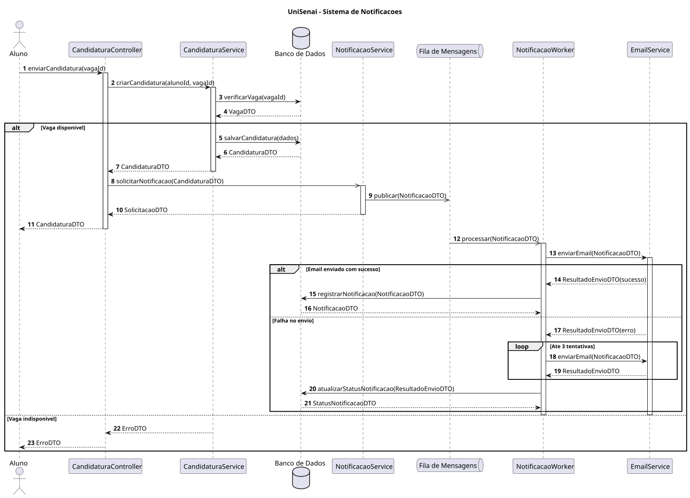
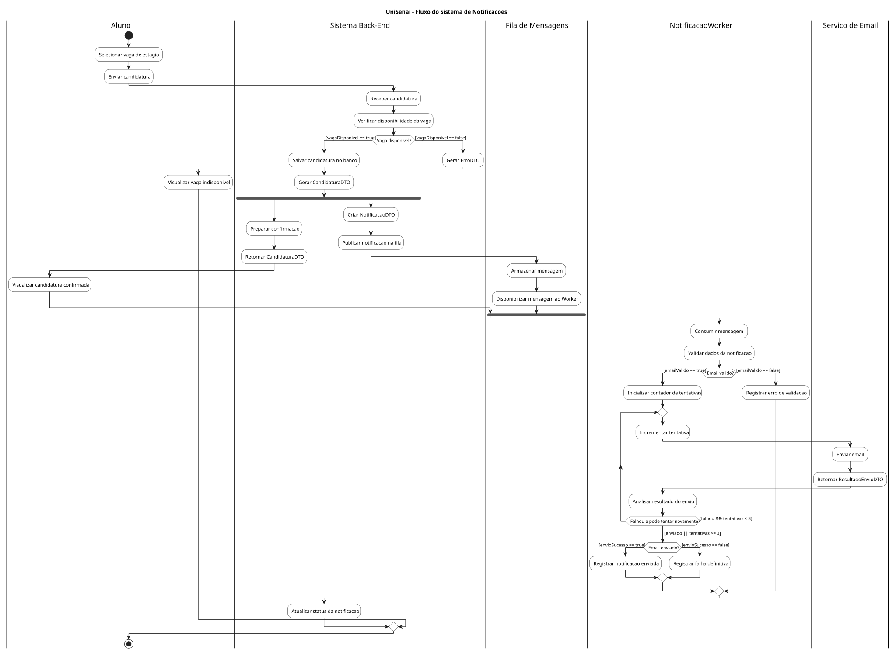
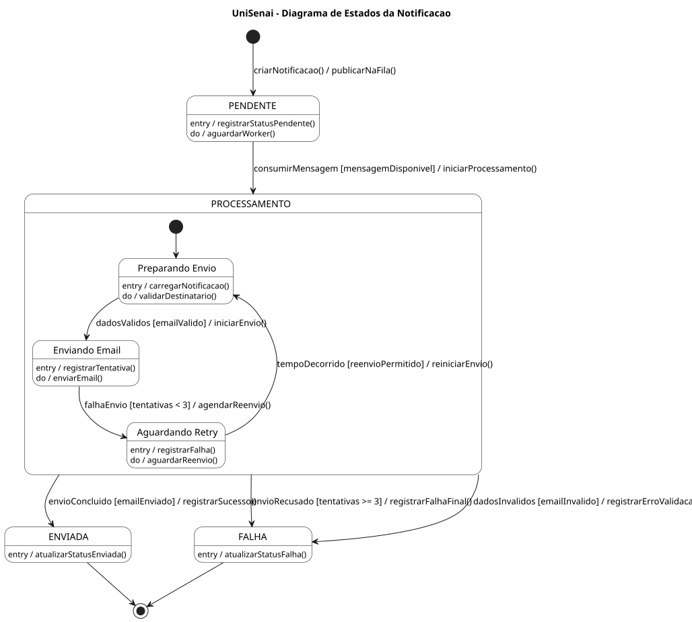
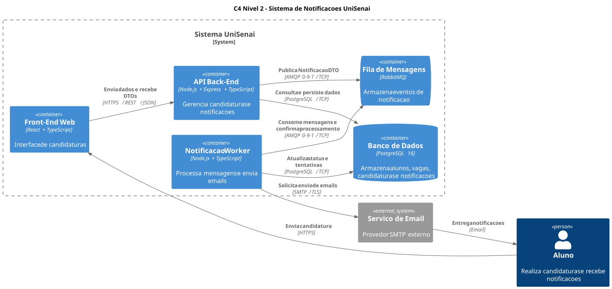

# Sistema de Notificações — UniSenai

## Descrição da funcionalidade

O Sistema de Notificações da UniSenai informa os alunos sobre eventos relacionados às candidaturas para vagas de estágio. Quando o aluno envia uma candidatura, o sistema verifica a disponibilidade da vaga e registra a solicitação. Caso a vaga esteja indisponível, o aluno recebe uma mensagem de erro e a notificação não é criada.

Após o registro da candidatura, o sistema prepara uma notificação e publica uma mensagem em uma fila. O aluno recebe a confirmação da candidatura sem precisar aguardar o envio do e-mail. Um processo independente (Worker) consome a mensagem, solicita o envio ao serviço de e-mail e registra o resultado. Se houver falha, o sistema pode realizar novas tentativas, até o limite de três tentativas totais.

A arquitetura proposta utiliza React e TypeScript na interface, Node.js e Express no Back-End, PostgreSQL para persistência, RabbitMQ para mensageria e um Worker em Node.js para processamento assíncrono.

## 1. Diagrama de Sequência

O diagrama apresenta a ordem das interações entre aluno, controle de candidaturas, serviço de candidaturas, banco de dados, fila de mensagens, Worker e serviço de e-mail. Mostra o caminho de sucesso, a rejeição de uma vaga indisponível e o tratamento de falhas no envio.

## 2. Diagrama de Atividades com Raias

O diagrama representa as atividades do aluno, Back-End, fila de mensagens, Worker e serviço de e-mail. Mostra as decisões sobre disponibilidade da vaga e resultado do envio, além da execução concorrente entre confirmação da candidatura e solicitação de notificação.

## 3. Diagrama de Transição de Estados

O diagrama descreve o ciclo de vida de uma notificação, desde sua criação até o envio bem-sucedido ou a falha definitiva. Os estados principais são PENDENTE, PROCESSAMENTO, ENVIADA e FALHA. Também apresenta validação, tentativas de envio e condições de transição.

## 4. Diagrama C4 — Nível 2 (Contêineres)

O diagrama apresenta a organização arquitetural do sistema e a comunicação entre Front-End, API Back-End, PostgreSQL, RabbitMQ, Worker e provedor de e-mail. Identifica as tecnologias e os protocolos utilizados em cada integração.

## 5. ADR 0001 — Mensageria Assíncrona com RabbitMQ

**Status:** Proposto.

**Contexto:** O envio direto de e-mails durante a requisição de candidatura aumentaria o tempo de resposta e criaria dependência da disponibilidade do provedor externo.

**Decisão:** Adotar RabbitMQ para receber eventos de notificação e um Worker independente para processar os envios. A comunicação assíncrona permite confirmar a candidatura sem aguardar o e-mail.

**Consequências:** A solução reduz o acoplamento, facilita o reprocessamento de falhas e permite escalar o envio de notificações. Em contrapartida, aumenta a complexidade da infraestrutura, exige monitoramento e cuidados com mensagens duplicadas, tentativas de reenvio e consistência dos dados.
